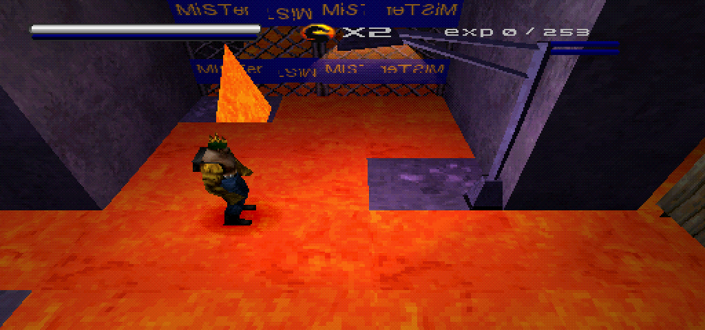
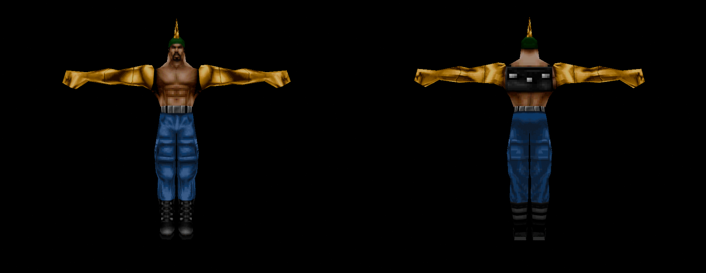
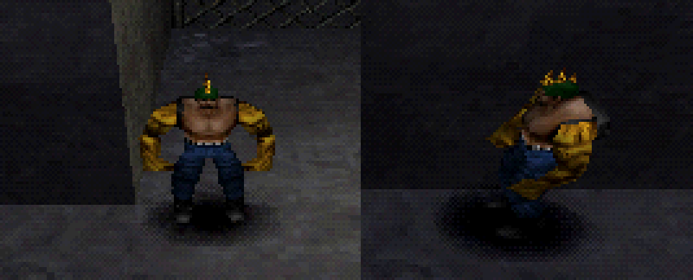
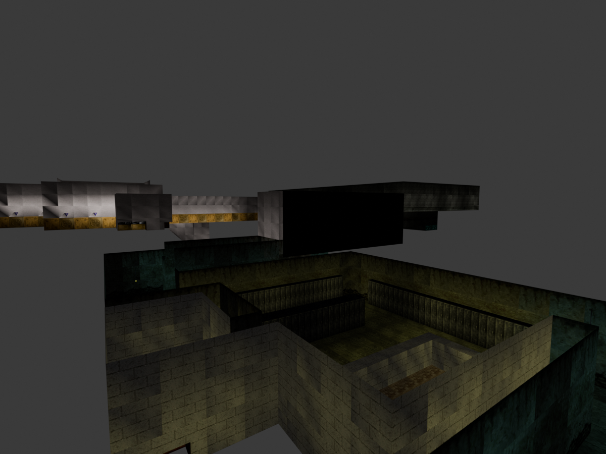
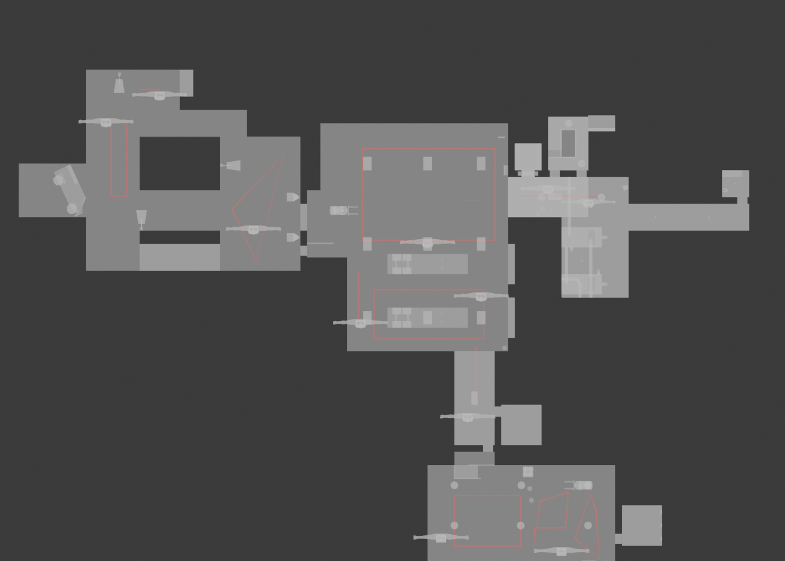
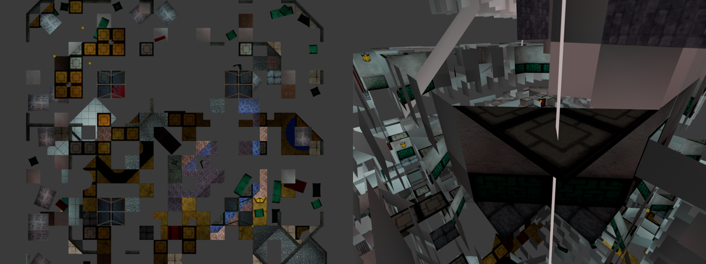

<div align="center">

# MKSF Modding Tools

**A Blender add-on and tools for modding *Mortal Kombat: Special Forces* (PlayStation, 2000)**

Characters · textures · levels · collision · enemies · items · lights — imported into Blender
and written straight back into the game's disc image.




*A golden-armed Jax walking on a re-textured, re-lit warehouse with a new (solid) pyramid — all made in Blender.*

</div>

---

## What it does

| | |
|---|---|
| **Characters** | Import any of the ~100 character models (`.skn`) with their real textures and palettes; edit geometry, UVs, body parts and textures; export. Every copy of the model on the disc (up to 18 of them) and every level texture dictionary is updated. |
| **Play as anyone** | `tools/swap_player.py` turns any character into the player model — e.g. play as **Jarek**. Animations keep working. |
| **Levels** | Import a level (`.bsp`) with textures, UVs and baked vertex lighting. Move, delete and add geometry — the BSP tree, leaf ranges, bounding spheres and zones are rebuilt; large faces are cut into tiles so the PS1 does not drop them. |
| **Collision** | The level's collision is a separate editable object. Delete, move or add faces; **Create object collision** makes any object solid. |
| **Enemies & items** | Enemies (real models), patrol routes (curves), pickups, lights and the player start are editable objects. Change positions, enemy types (incl. bosses), routes, items, light colours. |
| **Textures** | Paint in Blender or replace images; palettes are rebuilt when it is safe, otherwise colours snap to the existing palette. Edited images are packed into the `.blend` automatically. |
| **Disc images** | Reads `.cue`/`.bin` directly. Exports into a *copy* of the disc (created on first export), updating it in place on later exports; only changed sectors are rewritten, EDC/ECC fixed, everything verified by reading back. Original images are never written to. |

Everything round-trips byte-for-byte: importing and exporting without changes leaves the game data identical.
All features were tested in PCSX-Redux and on real hardware via **MiSTer FPGA**.

<div align="center">


<br>


</div>

## Installation

1. Download or clone this repository.
2. Build the extension zip and install it (needs Blender 4.2+ on `PATH`):
   ```sh
   blender/build.sh
   ```
   or zip the folder `blender/io_mksf` and install it in Blender via *Edit → Preferences → Get Extensions → Install from Disk*.
3. You need your own copy of the game as a `.cue/.bin` image (*Mortal Kombat - Special Forces (USA)*). The prototype disc is
   partly supported (see below).

## Quick start

All tools live in **File → Import / Export** and in the side panel **N → MKSF**.

**Edit a character**
1. *File → Import → MKSF model* → pick the `.cue`, then the model (e.g. `jaxsk` — that is Jax, the player).
2. Edit the mesh, UVs or textures. Body parts are vertex groups; materials are `<model>_tNN_pP` (texture / palette).
3. *File → Export → MKSF models/levels to disc image* → e.g. `MKSF Mod.bin` (created from your original on first export).

**Edit a level**
1. *File → Import → MKSF level* → the `.cue` → a level (`warehse1` is the first one).
   You get the level mesh, `<level>_collision` (red wireframe) and a collection `<level> entities`.
2. Cut, move, delete, add — split the level into as many objects as you like: everything using the level's materials is
   exported as one level.
3. To make something solid, select it and press **Create object collision**. Nothing becomes solid by itself
   (handy for light fixtures and decoration). Edit the collision object to remove or move existing collision.
4. Move enemies, edit their `mksf_type` / `mksf_script`, drag patrol route points, move items and lights, rotate
   `player_start`.
5. Export to your mod disc, then **save the `.blend`** — the export writes the game's polygon numbers back into the meshes.

**Play as another character**
```sh
python3 tools/swap_player.py jarek "MKSF Mod.cue"
```

## Prototype disc

The *Mortal Kombat Special Forces* prototype (with Sonya and many levels cut from the release — hotel, Kashgar, resort,
ski area, smugglers, docks, club, temple…) uses older formats. Characters work; levels import for viewing
(compressed walls are decoded, their texture is not yet known); writing prototype levels is disabled.

<div align="center"></div>

## Documentation

* [docs/FORMATS.md](docs/FORMATS.md) — every file format and EXE table that was reverse-engineered for this project
  (CDF, TXD, SKN, BSP, collision, level overlays, enemy/item tables, patrol bytecode).

## Credits

* **Made by [Claude](https://www.anthropic.com/claude)** (Anthropic's AI) for **[@Drak3Dev](https://github.com/Drak3Dev)**,
  who drove the project, tested every build on MiSTer FPGA and refused to accept "good enough".
  The reverse engineering, the add-on and the tools were written by Claude in conversation with Drak3Dev.
* Built on the research of **[ermaccer](https://github.com/ermaccer)** — his
  [mksftool](https://github.com/ermaccer/mksftool) (CDF / TXD / SKN extractor) was the starting point for the
  archive, texture and model formats. Thank you!
* Tools used along the way: [Ghidra](https://ghidra-sre.org/) with
  [ghidra_psx_ldr](https://github.com/lab313ru/ghidra_psx_ldr), [PCSX-Redux](https://github.com/grumpycoders/pcsx-redux).

*Mortal Kombat* is a trademark of Warner Bros. Entertainment. This project contains no game data; you need your own
copy of the game.

## License

[GPL-3.0](LICENSE)

---

<details>
<summary><b>🇷🇺 По-русски</b></summary>

**MKSF Modding Tools** — расширение для Blender и утилиты для моддинга *Mortal Kombat: Special Forces* (PS1).

* **Персонажи**: импорт любой модели с текстурами и палитрами, правка геометрии, UV, частей тела и текстур, экспорт
  во все копии на диске.
* **Игрок за любого**: `tools/swap_player.py jarek "MKSF Mod.cue"` — играем за Джарека (анимации работают).
* **Уровни**: импорт с текстурами и запечённым светом; можно двигать, удалять, добавлять геометрию — дерево BSP,
  сферы листов и зоны пересобираются, крупные грани режутся на плитки.
* **Коллизия**: отдельный объект `<уровень>_collision`; кнопка **Create object collision** делает выделенное твёрдым.
  Никакой автоматики.
* **Враги, предметы, свет, старт игрока**: редактируемые объекты (тип врага, маршрут патруля, предмет, цвет света).
* **Образы дисков**: работа прямо с `.cue/.bin`; экспорт в копию диска с проверкой; оригиналы не трогаются.
* После экспорта уровня — **сохраните .blend**.

Сделано **Claude** (ИИ от Anthropic) для **@Drak3Dev**, который всё тестировал на MiSTer FPGA.
Использованы наработки **ermaccer** ([mksftool](https://github.com/ermaccer/mksftool)).

</details>
